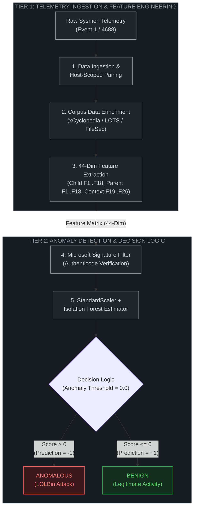

<div align="center">

# LotLDetection

### Living-off-the-Land Attacks Detection System by Machine Learning

[](https://www.python.org/)
[]()
[]()
[]()

---

</div>

## Overview

**LotLDetection** is a security machine learning framework designed to detect **Living-off-the-Land (LOLBin)** attack techniques across Microsoft Windows environments. By abusing trusted, cryptographically signed administrative utilities such as `certutil`, `wmic`, `powershell`, `mshta`, `rundll32`, or `regsvr32`, adversaries execute malicious actions while blending seamlessly into legitimate enterprise administration traffic.

Implemented strictly based on the authoritative research by **Utz Nisslmueller (2022)** (*"LOLBin detection through unsupervised learning: An approach based on explicit featurization of the command line and parent-child relationships"*), LotLDetection integrates **explicit 44-dimensional parent-child featurization**, **FastText dim=1 soft image hashing**, **Microsoft Authenticode digital signature filtering**, and **unsupervised Isolation Forest anomaly estimation**.

---

## System Workflow

The detection engine processes incoming process telemetry through a multi-stage hybrid pipeline:



### Execution Steps:
1. **Input and Ingestion:** Streams raw Windows Sysmon Event ID 1 (Process Create) and Windows Security Event ID 4688. Joins host-scoped Parent-Child identities via `(DatasetId, Computer, ProcessGuid/PID)` to prevent cross-machine process collisions.
2. **Corpus Data Enrichment (Thesis §5.2.2):** References `data/external/` catalogs (`xCyclopedia` 2,329 binaries, `LOTS Project` abused domains, `FileSec` dangerous extensions). Computes corpus-wide argument frequencies, character distribution baselines, and creation time delta bounds ($\min(\Delta t), \max(\Delta t)$).
3. **44-Dimensional Feature Extraction (Thesis §5.2.3):**
   - **Child Command Line ($F_1 \dots F_{18}$):** 18 boolean indicators on argument rarity, syntax obfuscation (`^`, `""`, `set`, `;;`), hex tokens, Chi-square character ratios, remote URLs, untrusted code paths, base64 tokens, Shannon entropy $> 7.0$, LSASS dumping keywords, and Alternate Data Streams (`ADS`).
   - **Parent Command Line ($F_1 \dots F_{18}$):** The identical 18 boolean indicators evaluated on the parent process command line ($18 \times 2 = 36$ dimensions).
   - **Contextual Features ($F_{19} \dots F_{26}$):** FastText `dim=1` soft image embeddings for parent/child (F19-F20), PE `OriginalFileName` mismatch detection (F21-F22), normalized time delta (F23), Integrity Level 1..6 (F24-F25), and Authenticode validity (F26) ($36 + 8 = 44$ dimensions).
4. **Microsoft Signature Filter:** Enforces Definition 2.1.1 by retaining only process pairs where either child or parent carries verified Microsoft Authenticode signatures (`microsoft_signed == True`).
5. **StandardScaler & Isolation Forest:** Standardizes features via z-score normalization and computes anomaly scores using an ensemble of 200 isolation trees with calibrated contamination.

---

## Evaluation Results

### Synthetic Smoke-Test Evaluation

The 24-row test is synthetic, with only 12 unique command pairs. Its filename follows the BOTSv2 quota protocol and does not identify original BOTSv2 telemetry. These metrics do not establish real-world detection accuracy. All 600 distinct eligible command pairs in the current raw corpus already appear in training, leaving no independent real candidates for the remaining quotas.

```text
Test [Synthetic Smoke Test]: 24 evaluated samples (16 Good/Benign, 8 Bad/LOLBin)
                  precision    recall  f1-score   support

Bad (LOLBin / -1)     1.0000    0.6250    0.7692         8
Good (Benign / 1)     0.8421    1.0000    0.9143        16

         accuracy                         0.8750        24
        macro avg     0.9211    0.8125    0.8418        24
     weighted avg     0.8947    0.8750    0.8659        24

TN=16 FP=0 FN=3 TP=5
FPR=0.0000 (0.0% False Positive Rate - Zero False Alarms)
Excluded=0 (the normalized 24-row fixture already omits those two pairs)
```

### Dataset Sample Statistics

| Dataset Layer | Source File / Partition | Total Events / Pairs | Eligible Pairs | Notes & Operational Status |
| :--- | :--- | :---: | :---: | :--- |
| **Raw Telemetry Ingestion** | `data/raw/*` | **1,826,634 events** | — | Streaming ingestion via 100,000-event chunks |
| **Parent-Child Ingestion** | Raw logs to disk-indexed pairs | **11,699 pairs** | 1,273 pairs | Excluded 10,402 unsigned pairs, 24 duplicate executions |
| **TRAINING BASELINE** | `data/processed/train/train_baseline.csv.gz` | **1,273 pairs** | **1,273 pairs** | $1,273 \times 44$ matrix, 153 binaries; isolated from synthetic data |
| **SYNTHETIC SMOKE TEST** | `data/processed/test/test_botsv2.csv` | **24 canonical pairs** | **24 evaluated** | **16 Benign (66.7%)**, **8 LOLBin (33.3%)**; 0 excluded |
| **Research Benchmarks** | `data/processed/benchmarks/` | **674 pairs** | Quota targets | BOTSv1 (100), BOTSv2 (24), BOTSv3 (75), Splunk (175), MITRE (300) |

---

## Quick Start

### 1. Installation

Prerequisites: Python 3.11+ on Windows or Linux.

```powershell
cd D:\Github\LotL-Detection
python -m pip install -r requirements.txt
python -m pip install -r requirements-dev.txt
```

### 2. Model Training

Train the unsupervised Isolation Forest baseline on real signature-eligible process telemetry:

```powershell
# Using the main CLI dispatcher:
python main.py train

# Or using the dedicated training module:
python -m src.train --input data/processed/train/train_baseline.csv.gz --model models/detector.joblib
```

### 3. Model Evaluation

Evaluate the frozen detector on the current synthetic smoke-test data:

```powershell
# Using the main CLI dispatcher:
python main.py evaluate --input data/processed/test/test_botsv2.csv

# Or using the dedicated evaluation module:
python -m src.evaluate --input data/processed/test/test_botsv2.csv --model models/detector.joblib
```

### 4. Ad-Hoc Command Prediction & Scanning

Inspect arbitrary process creation exports for LOLBin anomalies:

```powershell
python main.py predict --input data/processed/test/test_botsv2.csv --model models/detector.joblib
```

### 5. Automated Verification

Execute the comprehensive test suite (unit tests, 44-feature assertions, data pipeline, and model persistence):

```powershell
python -B -m pytest -q
```
*Current test suite status:* **109 passed, 0 skipped, 0 failed**.

---

## Cấu trúc thư mục (Directory Structure)

```text
LotL-Detection/
├── configs/                            # Cấu hình hệ thống và nguồn dữ liệu
│   └── dataset_sources.json            # Định nghĩa các kho lưu trữ upstream và commit hash
│
├── data/                               # Dữ liệu huấn luyện, kiểm thử và danh mục tra cứu
│   ├── external/                       # Danh mục tri thức tĩnh (xCyclopedia, LOTS, FileSec, chữ ký số)
│   ├── raw/                            # Dữ liệu log telemetry thô bất biến (Sysmon EVTX, JSONL, logs)
│   └── processed/                      # Dữ liệu chuẩn hóa phục vụ huấn luyện và đánh giá
│       ├── train/                      # Baseline huấn luyện (train_baseline.csv.gz, features, metadata)
│       ├── test/                       # Tập dữ liệu kiểm thử (test_botsv2.csv/.jsonl, features)
│       └── benchmarks/                 # Dữ liệu benchmark chuẩn mực, báo cáo gán nhãn và annotations
│
├── docs/                               # Tài liệu kỹ thuật và nghiên cứu học thuật
│   ├── features.md                     # Đặc tả chi tiết 44 đặc trưng trích xuất theo nghiên cứu
│   ├── system_workflow_explained.md    # Tài liệu giải thích chi tiết luồng hoạt động của hệ thống
│   └── references/                     # Luận văn gốc của Utz Nisslmüller (TU Delft, 2022)
│
├── models/                             # Thư mục lưu trữ mô hình đã huấn luyện
│   └── detector.joblib                 # Mô hình hoàn chỉnh (StandardScaler + FastText + Isolation Forest)
│
├── reports/                            # Báo cáo đánh giá và kết quả huấn luyện
│   ├── train/                          # Báo cáo huấn luyện (thông số mô hình, phân phối ký tự, delta thời gian)
│   ├── evaluate/                       # Báo cáo kiểm thử (bảng số liệu, ma trận nhầm lẫn, kết quả dự đoán)
│   ├── data/                           # Báo cáo di chuyển cấu trúc dữ liệu và đánh giá JSONL
│   └── refactor_smoke/                 # Báo cáo kiểm thử smoke test sau khi tái cấu trúc
│
├── scripts/                            # Các script tiện ích hỗ trợ dự án
│   └── generate_annotations.py         # Script tự động sinh nhãn heuristic cho benchmark
│
├── src/                                # Mã nguồn chính của hệ thống phát hiện LOLBin
│   ├── __init__.py
│   ├── data_loader.py                  # Chuẩn hóa log Sysmon/Security & ghép cặp tiến trình cha-con
│   ├── enricher.py                     # Làm giàu dữ liệu corpus (xCyclopedia, LOTS, FastText dim=1)
│   ├── features.py                     # Trích xuất 44 chiều đặc trưng dòng lệnh và ngữ cảnh
│   ├── model.py                        # Kiến trúc mô hình LOLBinDetector & quản lý đóng gói/lưu trữ
│   ├── train.py                        # Module và CLI huấn luyện mô hình
│   ├── evaluate.py                     # Module và CLI đánh giá mô hình
│   └── pipeline/                       # Pipeline thu nạp dữ liệu, lọc baseline và tạo benchmark
│       ├── __init__.py
│       ├── auto_annotation.py          # Tự động gán nhãn cho tập benchmark dựa trên heuristic/IOC
│       ├── baseline_builder.py         # Lọc và xây dựng tập dữ liệu huấn luyện baseline
│       ├── benchmark_builder.py        # Xây dựng các tập dữ liệu benchmark kiểm thử
│       ├── cli.py                      # Giao diện dòng lệnh (CLI) cho pipeline dữ liệu
│       ├── cli_support.py              # Các hàm trợ năng hỗ trợ CLI
│       ├── data_policy.py              # Định nghĩa quy tắc và chính sách lọc dữ liệu
│       ├── dataset_export.py           # Xuất dữ liệu đã xử lý sang các định dạng chuẩn
│       ├── ingestion.py                # Thu nạp telemetry thô, ghép cặp cha-con theo máy chủ
│       ├── pair_schema.py              # Định nghĩa schema cấu trúc cặp tiến trình cha-con
│       └── splunk_export.py            # Tiện ích xuất dữ liệu tích hợp Splunk
│
├── tests/                              # Bộ kiểm thử tự động toàn diện (unit & integration tests)
│   ├── conftest.py                     # Cấu hình fixtures và mock dữ liệu kiểm thử
│   ├── test_benchmark.py               # Kiểm thử quy trình tạo benchmark và hạn ngạch (quotas)
│   ├── test_data_pipeline.py           # Kiểm thử thu nạp, ghép cặp và khử trùng lặp dữ liệu
│   ├── test_features.py                # Kiểm tra tính toán 44 đặc trưng và điều kiện biên
│   └── test_model.py                   # Kiểm thử lưu trữ/nạp mô hình và logic dự đoán
│
├── .gitignore                          # Cấu hình bỏ qua tệp tin trong Git
├── download_datasets.py                # Tải danh mục tri thức đe dọa (threat intel) & catalogs ngoài
├── fetch_additional_data.py            # Tải các phân vùng log telemetry bổ sung
├── main.py                             # Điểm điều phối CLI chính (train, evaluate, predict)
├── pytest.ini                          # Cấu hình chạy kiểm thử Pytest
├── README.md                           # Tài liệu tổng quan dự án và hướng dẫn sử dụng
├── requirements-dev.txt                # Thư viện phụ thuộc cho môi trường phát triển & kiểm thử
└── requirements.txt                    # Thư viện phụ thuộc chính để chạy ứng dụng
```

---

## References

1. **Utz Nisslmueller:** *LOLBin detection through unsupervised learning: An approach based on explicit featurization of the command line and parent-child relationships*, Master's Thesis, Faculty of Electrical Engineering, Mathematics and Computer Science (EEMCS), Delft University of Technology (TU Delft), 2022.
2. **LOLBAS Project:** Living Off The Land Binaries and Scripts: https://lolbas-project.github.io
3. **Strontic xCyclopedia:** Executable Documentation & Exact-Hash Metadata: https://strontic.github.io/xcyclopedia/
4. **LOTS Project:** Living Off Trusted Sites: https://lots-project.com/
5. **FileSec:** Dangerous File Extensions & Execution Vectors: https://filesec.io/
6. **SwiftOnSecurity Sysmon-Config:** High-Fidelity Sysmon Configuration: https://github.com/SwiftOnSecurity/sysmon-config
7. **MITRE ATT&CK Framework:** Adversarial Tactics, Techniques, and Common Knowledge: https://attack.mitre.org/

---

<div align="center">
  <sub>LotLDetection is an open-source cybersecurity project developed for enterprise threat detection and academic research.</sub>
</div>
